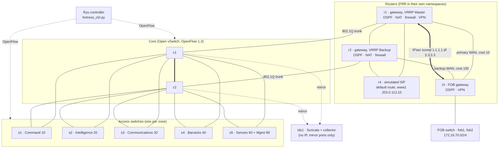
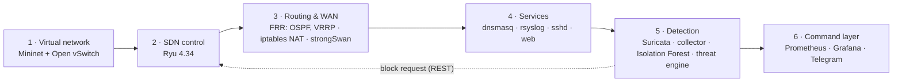
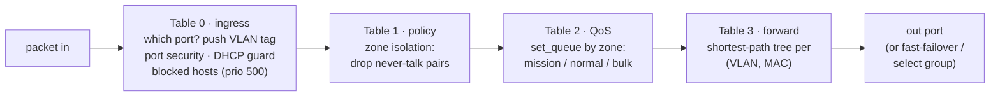
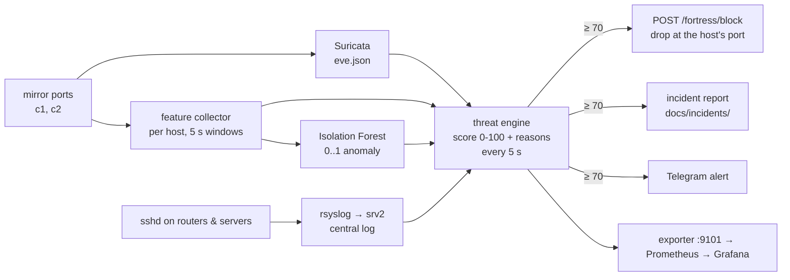

# Fortress-Net architecture

How the lab is built, layer by layer, and how the pieces talk to each other. Every address and
name below comes from [`config/fortress.yaml`](../config/fortress.yaml); the reasons behind each
choice are in [`decisions.md`](decisions.md) (cited as D-numbers).

## 1. The whole network

- **Two cores, five access switches.** Every access switch has an uplink to *both* cores, so any
  single cable or core can fail. That makes loops, which the controller handles by computing
  loop-free forwarding trees itself (no spanning tree; D21).
- **Two cables between c1 and c2**, used together as one logical link (link aggregation). The
  controller does it with an OpenFlow *select group* rather than an OVS bond, because OVS bonds
  only work when the switch decides forwarding itself (D24).
- **r1 and r2 share every zone's gateway** (`.1`) using VRRP: r1 is Master (priority 120), r2 is
  Backup (100) and takes over if r1 dies (D19).
- **ids1** has no IP address at all. It receives a copy of every packet on c1 and c2 (mirror
  ports) and is invisible to the hosts it watches (D30).

## 2. Addressing

| Zone | VLAN | Subnet | Gateway (VRRP VIP) | Hosts | May start connections to |
|------|------|--------|--------------------|-------|--------------------------|
| Command Center | 10 | 192.168.10.0/24 | .1 (r1 .2, r2 .3) | cmd1, cmd2 | everything |
| Intelligence | 20 | 192.168.20.0/24 | .1 | intel1, intel2 | Command only |
| Communications | 30 | 192.168.30.0/24 | .1 | comms1, comms2 | Command, servers, FOB |
| Barracks | 40 | 192.168.40.0/24 | .1 | bar1, bar2, bar3 (the insider) | servers, internet |
| Servers | 60 | 10.10.60.0/24 | .1 | srv1 DHCP/DNS, srv2 syslog, srv3 web | everything |
| Management | 99 | 192.168.99.0/24 | .1 | admin1 | admin SSH |
| FOB | — | 172.16.70.0/24 | r3 .1 | fob1, fob2 | over the VPN |

Router links are /30s (two usable addresses, exactly enough for a point-to-point cable):
r1-r2 10.0.0.0/30, **r1-r3 10.0.0.4/30 (primary WAN)**, r2-r3 10.0.0.8/30 (backup WAN),
r1-r4 10.0.0.12/30, r2-r4 10.0.0.16/30. Each router also has a **loopback** equal to its OSPF
router ID (r1 1.1.1.1 … r4 4.4.4.4), and the VPN runs between the loopbacks so it survives a cut
WAN cable (D39).

Hosts in the zones get their address from **DHCP** (dnsmasq on srv1, relayed by r1/r2) and
resolve names under `fortress.mil`. Addresses are fixed per host (MAC → IP), so the detection
and the incident reports always name the same host.

## 3. The six layers

| Layer | Runs where | Main files |
|-------|-----------|------------|
| 1. Virtual network | Mininet hosts = Linux network namespaces; switches = OVS bridges | [`topology/fortress_topo.py`](../topology/fortress_topo.py), [`topology/labconfig.py`](../topology/labconfig.py) |
| 2. SDN controller | VM root namespace, Python 3.9 venv | [`controller/fortress_ctrl.py`](../controller/fortress_ctrl.py) + `vlan.py`, `paths.py`, `netgraph.py`, `pipeline.py`, `response.py`, `rest_api.py` |
| 3. Routing & WAN | inside each router's namespace | [`configs/frr/`](../configs/frr), [`configs/iptables/`](../configs/iptables), [`topology/vpn.py`](../topology/vpn.py) |
| 4. Services | inside srv1-srv3 and every router | [`configs/dnsmasq/`](../configs/dnsmasq), [`configs/rsyslog/`](../configs/rsyslog), [`configs/ssh/`](../configs/ssh) |
| 5. Detection | ids1 (Suricata, collector); the engine in the VM root | [`detection/`](../detection) |
| 6. Command layer | VM root namespace | [`monitoring/`](../monitoring), [`detection/alerts.py`](../detection/alerts.py) |

Everything is started in order by [`topology/services.py`](../topology/services.py): controller
→ topology → OSPF + VRRP + NAT → DHCP → VPN → SSH → logging → web → IDS → collector → engine →
monitoring. Each daemon gets its own config, PID file and log under `/etc/fortress/<node>/`,
`/var/run/fortress/<node>/` and `/var/log/fortress/<node>/`, because Mininet hosts share one
filesystem (D12). Configs are **rendered from Jinja2 templates** in [`configs/`](../configs) by
[`topology/render_configs.py`](../topology/render_configs.py), so `fortress.yaml` is the only
place an address is ever written down (D15).

## 4. Inside the controller: a four-table pipeline

- **VLANs under SDN (D10).** OVS only applies port VLAN tags in its built-in switching mode, so
  under the controller, table 0 pushes the 802.1Q tag where a host plugs in, the cores carry it,
  and the last switch pops it. Router trunk ports stay tagged (`r1-eth0.10` and so on).
- **Forwarding (D21).** For every known (VLAN, MAC) the controller computes a shortest-path tree
  over the switch graph (cables through c2 cost a bit more, so c1 is preferred) and installs one
  rule per switch. Broadcasts and unknown destinations are flooded *by the controller* only to
  the edge ports of that VLAN, so there are no loops and no storms.
- **Two failover modes (D25).** *Reactive* (T09): when a port goes down, the controller recomputes
  every tree and reinstalls the rules that changed (logged in
  `/var/log/fortress/ryu/reroutes.jsonl`). *Proactive* (T11): rules point at OpenFlow
  **fast-failover groups** holding a primary and a backup port, so the switch itself switches to
  the backup the moment the primary port dies, without asking the controller.
- **Security in the pipeline (D27, D34).** Pairs of zones that may never talk are dropped in table
  1; a host may only send with its own MAC and IP from its own port (table 0); DHCP answers only
  come from srv1's port; and a blocked host gets a priority-500 drop rule at its own access port,
  with an expiry.

## 5. Self-healing: who repairs what

| Failure | What notices | What repairs it | Measured (median, 5 runs) |
|---------|--------------|-----------------|---------------------------|
| Core–access cable cut | the switch (port down) | controller reroute / fast-failover group | 23 ms reactive, 31 ms proactive |
| One of the two c1-c2 cables | the switch | select group drops the dead member | 19 / 19 ms |
| r1 loses power | VRRP adverts stop (every 200 ms) | r2 becomes Master in 0.7 s; traffic moves in ~20-50 ms | 37 / 28 ms |
| Primary WAN r1-r3 cut | carrier loss, OSPF (1 s hellos) | OSPF reroutes via r2; VPN follows (loopbacks) | 27 / 48 ms |

Numbers from [`docs/results/summary.csv`](results/summary.csv); how they were measured is in
[`testing.md`](testing.md).

## 6. Detection and response

The score ([`detection/threat_engine.py`](../detection/threat_engine.py), D33):

| Signal | Points |
|--------|--------|
| anomaly (model's verdict, scaled) | up to 30 |
| Suricata alert from this host in the last 30 s | +30 |
| more than 50 destination ports in one 5 s window | +30 |
| 20+ unanswered SYNs or resets coming back | +15 |
| 5+ failed SSH logins in 120 s (central log) | +25 |
| correlation: scan, then logins | +15 |
| correlation: IDS brute-force rule **and** central log agree | +15 |

0-39 Normal, 40-69 Suspicious, **70-100 Breach**. The weights mean a breach always needs **two
independent signals**: one IDS alert alone is 30, and the model alone at most 30. Every point
comes with a sentence saying why, and that sentence goes into the dashboard, the incident report
and the Telegram message.

## 7. Monitoring

The exporter ([`monitoring/exporter.py`](../monitoring/exporter.py)) reads the lab's own files
and the controller's REST API on every scrape and publishes 23 `fortress_*` metrics; Prometheus
scrapes it every 5 s; Grafana's **Command Center** dashboard (12 panels, provisioned from
[`monitoring/grafana/`](../monitoring/grafana)) shows zone health, VRRP state, OSPF neighbours,
VPN state, threat scores with reasons, blocked hosts and recent reroutes (D35).
