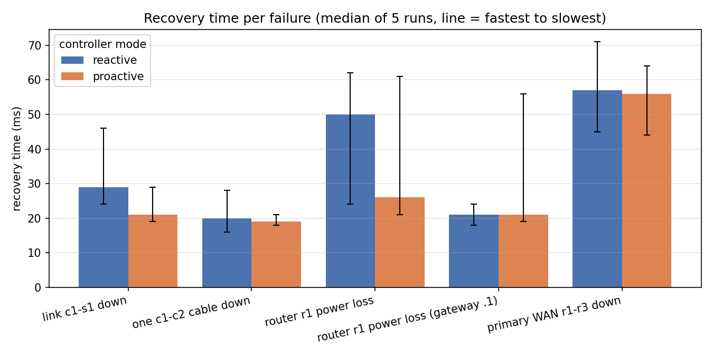

# Fortress-Net: a self-healing, AI-assisted secure network for a military base

*CIE3 Computer Networks mini project. Draft report.*
*Team: _(names and USNs)_ · Guide: _(name)_ · Date: _(submission date)_*

---

## Abstract

We built a working model of a military base network in which every component is real Linux
networking software: Open vSwitch switches run by a Ryu SDN controller, FRRouting routers running
OSPF and VRRP, a strongSwan IPsec VPN to a forward operating base, and a detection layer built on
Suricata and an Isolation Forest model. The network repairs itself: a cut cable, a dead gateway
router or a lost WAN link is bypassed automatically, and an automated chaos test measured every
recovery five times in two controller modes. All 50 runs healed without human help, typically in
20-60 ms. The network also defends itself: a compromised host scanning from the Barracks is
scored 92-93/100 from four independent signals, with the reason for every point written down, and
is cut off at its own switch port within 1-7 seconds, while its neighbours carry on unaffected.

## 1. Introduction

A base network has to keep working while things go wrong: cables are cut, equipment fails, and
the most dangerous attacker is often already inside. Textbook networks handle the first two with
redundancy and the third with firewalls at the edge, which do nothing about an insider.

**Problem statement.** Design and build a base network that (1) recovers from link and equipment
failures by itself, and can prove how fast; (2) keeps zones of different sensitivity apart; and
(3) detects an attack from inside, explains why it thinks so, and contains it automatically.

**Objectives.**
1. Six zones on separate VLANs with a clear "who may talk to whom" policy.
2. No single point of failure in switching, routing or the WAN.
3. Two failover approaches, reactive and proactive SDN, compared with measured numbers.
4. Encrypted connectivity to a forward operating base (FOB).
5. Insider detection from several independent sources, with an explainable score.
6. Automatic containment, alerting and an incident record.

## 2. Design

### 2.1 Topology

Two core switches (c1, c2) joined by two cables, five access switches each uplinked to both
cores, two gateway routers (r1, r2) with 802.1Q trunks to the cores, a FOB router (r3) and a
simulated ISP (r4). A detailed diagram is in [`docs/architecture.md`](../architecture.md).

### 2.2 Addressing

| Zone | VLAN | Subnet | May reach |
|------|------|--------|-----------|
| Command Center | 10 | 192.168.10.0/24 | all zones |
| Intelligence | 20 | 192.168.20.0/24 | Command only |
| Communications | 30 | 192.168.30.0/24 | Command, servers, FOB |
| Barracks | 40 | 192.168.40.0/24 | servers, internet |
| Servers | 60 | 10.10.60.0/24 | all zones |
| Management | 99 | 192.168.99.0/24 | admin SSH only |
| FOB | — | 172.16.70.0/24 | over the VPN |

Zones are /24s (254 hosts, plenty of room for growth). Router-to-router links are /30s (exactly
two usable addresses). Each zone's gateway is the virtual address `.1`, shared by r1 (`.2`) and
r2 (`.3`). All values live in one file, `config/fortress.yaml`, and every configuration is
generated from it, so the design and the running network can't drift apart.

### 2.3 Layers

| Layer | Technology | Role |
|-------|-----------|------|
| Virtual network | Mininet, Open vSwitch | hosts as Linux network namespaces, real switches |
| SDN control | Ryu 4.34 (OpenFlow 1.3) | VLANs, loop-free forwarding, failover, isolation, QoS, blocking |
| Routing and WAN | FRRouting (OSPF, VRRP), iptables, strongSwan | routing, gateway redundancy, NAT, firewall, VPN |
| Services | dnsmasq, rsyslog, sshd | DHCP/DNS, central logging, admin access |
| Detection | Suricata, scikit-learn, our threat engine | signatures, behaviour, scoring |
| Command layer | Prometheus, Grafana, Telegram | dashboard and alerts |

## 3. Implementation

### 3.1 Switching under an SDN controller
The controller ([`controller/fortress_ctrl.py`](../../controller/fortress_ctrl.py)) installs a
four-table OpenFlow pipeline on every switch: *ingress* (tag the frame with its VLAN, port
security, DHCP guard, blocks), *policy* (drop zone pairs that may never talk), *QoS* (choose a
queue), *forward* (a shortest-path tree per destination). Because both cores connect to every
access switch, the physical network has loops; the controller avoids them by computing trees
itself rather than running spanning tree. The two c1-c2 cables are combined as an OpenFlow select
group, which we chose over an OVS LACP bond because bonds only work when the switch makes its own
forwarding decisions (decision D24).

### 3.2 Two ways to survive a cut cable
- **Reactive (T09):** the switch reports the port down; the controller recomputes every tree and
  replaces the rules that changed, logging each event.
- **Proactive (T11):** rules point at OpenFlow *fast-failover groups* holding a primary and a
  backup port, so the switch moves traffic itself the moment the primary dies.

### 3.3 Routing, redundancy and the VPN
r1-r4 run OSPF area 0 with 1 s hellos, and link costs make r1-r3 the primary WAN and r2-r3 the
backup; r2 also has a floating static route to the FOB in case OSPF loses every path. r1 and r2
share each zone's gateway with VRRP (r1 priority 120, preemption on, 200 ms adverts). r1 and r2
NAT traffic to the internet and filter traffic between zones statefully. The VPN is IKEv2 with
AES-256-GCM ESP in tunnel mode between r1 and r3, anchored on loopback addresses so it follows
OSPF's detour if the WAN cable is cut.

### 3.4 Detection
Suricata watches copies of all traffic on both cores (ids1 has no IP address, so it cannot be
attacked over the network). A collector turns the same mirrored packets into six features per
host every 5 seconds. An Isolation Forest, trained only on normal traffic, scores how unusual each
host's behaviour is (2.2% false positives on unseen normal traffic). Failed SSH logins come from
the routers' and servers' own logs, collected centrally on srv2.

### 3.5 Scoring, response and alerting
The threat engine combines these into one score out of 100 per host every 5 seconds, with the
reason for every point (see [`architecture.md`](../architecture.md) §6 for the table). The weights
make a breach (70+) impossible from one source alone. A breach triggers three things: a REST call
asking the controller to drop the host's traffic at its own access port (with an expiry), an
incident report in `docs/incidents/`, and a Telegram message with the same reasons.

## 4. Testing and results

Full details and how to repeat every test: [`docs/testing.md`](../testing.md).

### 4.1 Automated health and failure suite
`start_all.sh --check` runs 142 checks on the live network, from DHCP leases and OSPF adjacencies
to a full insider attack, including eight disruptive tests that break something on purpose and
check the repair. Final result: **142/142**.

### 4.2 Recovery, measured (chaos test)

5 runs per failure and mode, 100 pings/s requested (about 55/s achieved), median recovery time:

| Failure | Mechanism | Reactive | Proactive | Healed by itself |
|---------|-----------|----------|-----------|------------------|
| Core–access cable cut | SDN reroute / fast-failover | 29 ms | 21 ms | 10/10 |
| One of two core cables cut | link aggregation | 20 ms | 19 ms | 10/10 |
| Gateway router r1 loses power | VRRP | 50 ms | 26 ms | 10/10 |
| Primary WAN cut | OSPF, VPN on loopbacks | 57 ms | 56 ms | 10/10 |

The measurement resolves about 20 ms, so most of these are at its floor: the honest conclusion is
that every failure is bypassed automatically in well under 0.1 s. The proactive mode's advantage
is clearest when r1 dies.

### 4.3 Insider attack
Over our timed runs, a 200-port sweep from Barracks host bar3 was first flagged by Suricata about
1.3 s after it started, scored 92-93/100 from four signals (model, IDS signature, port sweep,
refused connections), and blocked at bar3's own switch port 1.3-6.3 s after the sweep began; bar1
on the same switch was unaffected. The spread is set by the engine's 5-second scoring cycle.
`chaos_test.py` repeats this five times and charts it (`detection_to_block.png`).

### 4.4 Mission-priority QoS
With the Barracks flooding at twice the link rate, the Command Center's round-trip time stayed
at 0.04 ms while the Barracks' own rose to 11.4 ms: the flood hurts only the zone that causes it.

## 5. Discussion

**What testing found.** The chaos test's first results looked perfect, and that was the warning
sign: a WAN failover can't take 35 ms when OSPF's dead interval is 4 s. Looking at the raw data
uncovered a measuring bug (an outage that never ended was invisible) and a real fault: the VPN
was tied to the addresses on the WAN cable and died with it, so base-to-FOB traffic stopped until
the cable was repaired. Moving the tunnel onto loopback addresses, which is the standard practice
on real routers, fixed it, and further repeated runs exposed and fixed three more VPN problems
(D39). We also built and then dropped threat-aware rerouting (T22), because in this topology an
access switch is never a transit node, so there is no alternative path to steer a zone onto (D37).
We think these are among the most useful results of the project: they show the network was
tested, not assumed to work.

**Limits.**
- When r1 dies, FOB traffic pauses for about 3-5 s, because the tunnel lives on r1 and r3 must
  first detect that r1 is gone. A second tunnel on r2 would remove this.
- Containment takes seconds, not milliseconds, because behaviour is judged in 5-second windows.
- The lab runs in one VM: link speeds and timings are those of virtual interfaces, not hardware.

## 6. Conclusion

Fortress-Net meets its objectives: zones are isolated by VLAN and policy; there is no single point
of failure in switching, routing or the WAN, and every recovery was measured; reactive and
proactive SDN failover were compared on equal terms; the FOB link is encrypted and survives a cut
WAN; and an insider attack is detected from independent sources, explained, contained and
reported without human action.

**Future work:** a second VPN tunnel on r2; per-flow (not per-host) containment; training the
anomaly model on a longer, more varied baseline; running the same configuration on physical
switches that speak OpenFlow.

## References

1. OpenFlow Switch Specification 1.3.x, Open Networking Foundation.
2. RFC 2328, OSPF Version 2. RFC 5798, VRRP Version 3. RFC 7296, IKEv2. RFC 4303, ESP.
3. IEEE 802.1Q, Bridges and Bridged Networks (VLAN tagging).
4. Ryu SDN Framework documentation, ryu.readthedocs.io.
5. FRRouting user guide, docs.frrouting.org.
6. strongSwan documentation (swanctl.conf, VICI), docs.strongswan.org.
7. Suricata user guide, docs.suricata.io.
8. F. T. Liu, K. M. Ting, Z.-H. Zhou, "Isolation Forest", IEEE ICDM 2008.
9. B. Lantz, B. Heller, N. McKeown, "A Network in a Laptop: Rapid Prototyping for Software-Defined
   Networks" (Mininet), ACM HotNets 2010.

## Appendix: where to find things

| Item | File |
|------|------|
| All design decisions with reasons | [`docs/decisions.md`](../decisions.md) (D1-D39) |
| Architecture and diagrams | [`docs/architecture.md`](../architecture.md) |
| Cisco equivalents | [`docs/cisco-equivalents.md`](../cisco-equivalents.md) |
| Every test and result | [`docs/testing.md`](../testing.md), [`docs/results/`](../results) |
| The network's single source of truth | [`config/fortress.yaml`](../../config/fortress.yaml) |
| Incident reports | `docs/incidents/` (written by the lab at run time) |
