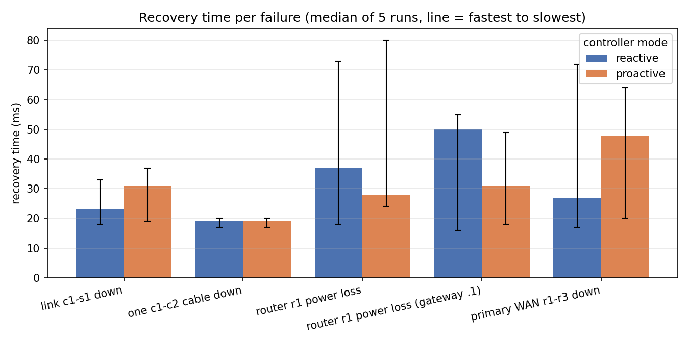
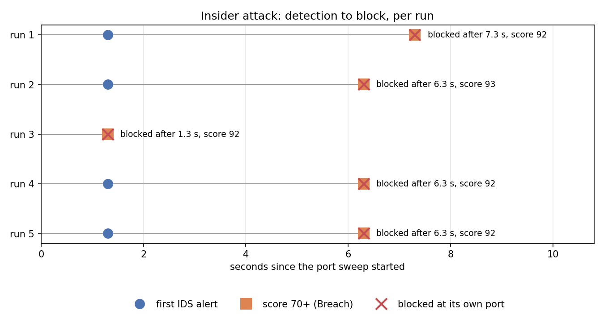

# Testing and results

Everything we tested, how to repeat it, and what it showed. Nothing here is a screenshot or a
one-off: each result comes from a script in the repository, and every number in the report comes
from a file in [`docs/results/`](results).

## 1. How to repeat every test

| Test | Command (from the Mac) | Time | Output |
|------|------------------------|------|--------|
| Environment | `./scripts/vm/vm.sh ./scripts/check_env.sh --smoke` | 1 min | ✅ per tool |
| Config | `./scripts/vm/vm.sh python3 scripts/check_config.py` | seconds | errors, if any |
| Full health + failure suite | `./scripts/vm/vm.sh sudo ./scripts/start_all.sh --check` | ~8 min | 142 checks, exit code = failures |
| Chaos test (T25) | `./scripts/vm/vm.sh sudo python3 scripts/chaos_test.py` | ~30 min | `results.csv`, `summary.csv`, `detection.csv`, 3 charts |
| One failure only | `./scripts/vm/vm.sh sudo python3 scripts/chaos_test.py --runs 1 --only WAN` | 2 min | same files |
| Threat scoring | `./scripts/vm/vm.sh '~/venvs/fortress/bin/python detection/threat_engine.py --self-check'` | seconds | worked examples pass |
| Demo rehearsal (T26) | `./scripts/vm/vm.sh sudo ./scripts/demo.sh --auto` | ~2 min | each step's evidence, total time |
| Clean-up proof | `./scripts/vm/vm.sh sudo ./scripts/stop_all.sh` | seconds | ✅ no processes, bridges, interfaces |

Only one lab can run in the VM at a time: each of these starts its own and clears any other.

## 2. The health and failure suite (`start_all.sh --check`): 142/142

[`topology/checks.py`](../topology/checks.py) runs these in order on the live lab. The first group
only looks; the second (marked ⚡) breaks things on purpose and checks the repair.

| Section | What it proves |
|---------|----------------|
| SDN controller | Ryu is up and sees all 8 switches and every link |
| Same-zone reachability | hosts in one VLAN reach each other |
| VLAN isolation on a shared switch | two VLANs on s5 cannot ARP each other |
| No broadcast storm | the dual uplinks (loops) don't melt the network |
| DHCP / DNS | every host gets its fixed address from srv1 through the relays; `srv1.fortress.mil` resolves |
| OSPF adjacencies | every router has all its neighbours Full |
| Routing between zones, FOB, internet | the allowed paths work |
| Primary WAN path | traffic to the FOB goes r1 → r3 (OSPF costs) |
| Floating static route | r2 holds the backup route to the FOB |
| NAT | the internet sees r1's ISP-side address, never a base address |
| VRRP | r1 Master, r2 Backup for all 6 zones; hosts use the virtual MAC |
| Zone isolation | each "may reach" rule from `fortress.yaml`, both the allowed and the denied directions |
| IPsec VPN | tunnel up; a capture of the WAN cable shows only ESP, no readable ICMP |
| SSH and central logging | admin SSH works only from Management; a failed login on r1 lands in srv2's log |
| Suricata | running on both mirrors; our rules loaded |
| Feature collector, threat engine, monitoring | each writes fresh data; Prometheus and Grafana serve it |
| Link aggregation | both c1-c2 cables are in the select group |
| Controller rules | the 4-table pipeline is installed on every switch |
| ⚡ WAN failover with the VPN | r1-r3 cut: the FOB is still reachable, the tunnel stays up, the detour r2-r3 carries only ESP |
| ⚡ VRRP failover | r1 dies: r2 Master in 0.7 s, 0 of 188 gateway pings lost, r1 takes over again (preemption), VPN back by itself |
| ⚡ Link aggregation failover | one core cable down: no loss |
| ⚡ Reactive rerouting | c1-s1 down: the controller reroutes and logs it |
| ⚡ Mission-priority traffic | a Barracks flood at 2x the link rate: Command's latency stays at 0.04 ms, Barracks' rises to 11 ms ([`qos.csv`](results/qos.csv)) |
| ⚡ Rogue devices | an unknown host and a fake DHCP server are both blocked |
| ⚡ Baseline traffic | the normal-traffic generator produces web, file, DNS and SSH traffic |
| ⚡ Insider scenario | port sweep → Suricata alert → Breach score from ≥2 signals → blocked at its own port, neighbour unaffected → incident report → unblock works |

## 3. The chaos test (T25): recovery, measured 5 times each

[`scripts/chaos_test.py`](../scripts/chaos_test.py) starts the lab once per controller mode and
repeats each failure 5 times while a high-rate ping runs between two hosts.
[`scripts/measure.py`](../scripts/measure.py) records:

- **recovery** = the longest time with no reply (the start and end of the run count as edges, so
  an outage that never ends can't hide);
- **healed** = replies were flowing again in the last second *before* the failure was repaired,
  i.e. the network fixed itself, not us.

Result, from [`summary.csv`](results/summary.csv) (all 50 runs healed by themselves):

| Failure | Mechanism | Reactive median (min-max) | Proactive median (min-max) |
|---------|-----------|---------------------------|----------------------------|
| Link c1-s1 down | SDN reroute / fast-failover | 23 ms (18-33) | 31 ms (19-37) |
| One c1-c2 cable down | link aggregation | 19 ms (17-20) | 19 ms (17-20) |
| r1 power loss (routed traffic) | VRRP | 37 ms (18-73) | 28 ms (24-80) |
| r1 power loss (pinging the gateway) | VRRP takeover | 50 ms (16-55) | 31 ms (18-49) |
| Primary WAN r1-r3 down | OSPF, VPN on loopbacks | 27 ms (17-72) | 48 ms (20-64) |

**Reading the numbers honestly.** Mininet hosts manage about 55 pings/s, so the measurement
resolves about 20 ms; most of these recoveries are at or near that floor. What the table really
shows: every failure heals by itself, in well under a tenth of a second, in both modes. Between
the modes there is **no consistent difference**: across two full runs, the faster mode flipped for
the cut cable and the WAN cut. The one repeatable gap is r1's power loss (proactive 26 and 28 ms,
reactive 50 and 37 ms), where the proactive backup buckets move traffic to r2's port without
waiting for the controller. In this small, fast lab the controller reacts almost as quickly as the
switch; fast-failover would matter more where the controller is far away or busy. VRRP itself takes 0.7 s to declare r2
Master, yet hosts lose nothing, because r2 already owns the virtual MAC and forwards as soon as
frames reach it (D39).

**Insider response timing** ([`detection.csv`](results/detection.csv)): the chaos test also runs
the insider scenario 5 times and times the first IDS alert, the Breach score and the block.
Result: **blocked in 5 of 5 runs, median 6.3 s** after the sweep started (1.3-7.3 s). The first
Suricata alert came 1.3 s in every run (the first check after the 200-port sweep finishes). The
block always landed in the same engine cycle as the Breach score; the spread is where the sweep
falls in the engine's 5-second cycle. Scores were 92-93, each from the same four signals (anomaly,
IDS signature, port sweep, refused connections).

## 4. Other measurements

| What | Result | Source |
|------|--------|--------|
| Anomaly model false positives | **2.2%** on 489 held-out normal rows (target < 5%) | D32 |
| Threat-scoring worked examples | all pass | `threat_engine.py --self-check` |
| QoS under a 100 Mbit/s Barracks flood (50 Mbit/s links) | Command RTT 0.04 ms, Barracks 11.4 ms | [`qos.csv`](results/qos.csv), D26 |
| First failover numbers (T09b, before T25) | link 51-68 ms, r1 51-52 ms | [`early.csv`](results/early.csv), D23 |
| Log volume per run | 62 MB → 204 KB after quietening strongSwan | D38 |
| VPN back after r1 recovers | 2-7 s | D39, `--check` |
| Demo rehearsal | all 9 steps in 31 s without pauses | `demo.sh --auto` |

## 5. What testing found (and what we changed)

Testing earned its keep: each of these was found by a test, not by reading code.

| Found by | Problem | Fix | Decision |
|----------|---------|-----|----------|
| `--check` | the OVS LACP bond never formed under the controller | link aggregation with OpenFlow select groups | D24 |
| `--check` | baseline traffic never included the web server, so the model never saw file transfers | always include srv3 | D32 |
| `--check` | a non-strict OpenFlow delete removed the host's normal rule along with its block | strict delete with priority | D34 |
| `--check` | srv2 collected 121,557 log lines (62 MB) per run, nearly all VPN keepalives | quieter strongSwan logging, rotation, read only the tail | D38 |
| building T22 | a zone can't be steered off the mission path in this topology | T22 dropped, with the reasoning | D37 |
| chaos test | `measure()` reported 21 ms for an outage that lost 994 of 1108 pings | count silence at the edges; record `healed` | D39 |
| chaos test | the VPN died whenever the primary WAN cable was cut (tunnel was on the cable's own addresses) | tunnel between OSPF-advertised loopbacks | D39 |
| chaos test | the VPN never came back after r1's power loss | `keyingtries = 0`, one initiator, responder loaded first | D39 |
| demo rehearsal | FOB traffic pauses ~5 s while r1 is dead | known limit, explained in the demo; fix = second tunnel on r2 | D28 |

## 6. Known limits

- **r1 dying stops FOB traffic for about 3-5 s.** The tunnel lives on r1; r3 must first notice r1
  is dead (dead-peer detection) before traffic falls back, unencrypted, via r2. A second tunnel on
  r2 would fix it (D28).
- **The first WAN cut straight after a router power loss** sometimes takes about 4.9 s instead of
  ~50 ms; it still heals by itself (D39).
- **Ping resolution is ~20 ms**, so differences below that are not meaningful.
- **Detection needs the 5 s windows**, so a block takes 1-10 s, not milliseconds.
